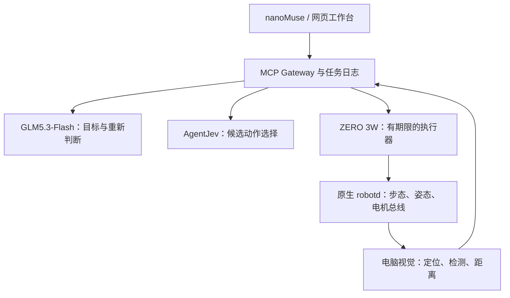

# Microduck Harness

**nanoMuse Desktop + AgentJev + 自有 GLM5.3-Flash + 视觉服务 + ZERO 3W 原生 robotd。**

这是可以启动、通过网页或 MCP 操作的 **v0.3.0 工程**。目标硬件为完整 **15 舵机** XL330 Microduck，支持已核对的 robotd **0.16.3 / API 41** 和 **0.17.8 / API 44**。默认连接二维演示设备；真机路径已经实现原生通信、相机与 ToF 接入，但尚未在你的设备和模型服务上联调。

首版完成的目标类型：**指定区域探索、寻找目标、靠近目标并停下**。自主抓取、投放、完整房间建图和未知地形导航尚未实现。不会将“发送了一个动作”当作“目标完成”。

本版引入 [superobk/microduck-tools](https://github.com/superobk/microduck-tools) 的 **外置校准、相机配置和本机 Web 工具**，并提供两版原生源码补丁、当前进程生效检查，以及一份 TOML 生成电脑 / ZERO 配置的 `duck-deploy`。继续支持运行中可修改的模型设置、ArUco 打印与标定。API 尚未提供也可启动 live 工作台查看状态和填配置；模型未就绪时新任务会被拒绝。

**第一次完整部署从 [统一配置、原生部署与运行指南](docs/DEPLOYMENT.md) 开始。** 其中按顺序给出 Git clone、Python 环境、两端配置、原生源码构建与签名安装、真实校准、相机、AgentJev、GLM、首次任务、停止和回退的命令；原生篇已全文收录，不必拼接多份旧教程。

| 首轮需要的文件 | 内容 |
|---|---|
| [统一部署指南](docs/DEPLOYMENT.md) | v0.3 主入口：一份 TOML、两端启动脚本、完整原生命令与版本切换 |
| [部署配置模板](config/deployment.example.toml) | 版本、网络、路径、插件、视觉、初始模型参数与动作限额 |
| [插件来源与适配](integrations/microduck_tools/README.md) | 固定原始快照、双版本补丁、来源和验证边界 |
| [ArUco 打印包](output/pdf/microduck-aruco-print-pack.pdf) | 5 页 A4：ID 0–3 的 160 mm 地标，以及 20 mm 方格棋盘 |
| [图文放置指南](output/pdf/microduck-aruco-placement-guide.pdf) | 5 页中文指南：坐标、朝向、高度、标定和首轮操作 |
| [同 Wi-Fi 手工配置参考](docs/wifi-deployment.md) | 单独配置各进程的进阶参考；完整插件部署使用上方统一指南 |
| [运行时模型设置](docs/model-config.md) | 网页、REST、持久化、认证与任务配置版本 |
| [详细 ArUco 说明](docs/aruco-placement.md) | 打印尺度、完整矩阵、相机采集和标定 |

配套配置为 `config/aruco-lab.example.json`（视觉）和 `config/aruco-gateway.example.json`（任务与活动区）。这套地图不能直接配旧的 `config/live.example.json` 大范围边界；请成套使用或明确填写自己的实际区域。

## 1. 先运行完整演示

要求 Python 3.11+。先取得仓库，再进入本目录：

```bash
git clone https://github.com/superobk/microduck-harness.git
cd microduck-harness
python3 -m venv .venv
. .venv/bin/activate
python -m pip install -e '.[test]'
duck-harness gateway
```

打开 **http://127.0.0.1:8765**，输入“靠近纸团并停下”“寻找 marker_1”或“在指定区域内探索”。界面显示位置、目标、动作事件、任务状态和完成证据。按“停止当前任务与行走”取消。关闭浏览器不会取消已经接受的任务。

这个模式不要求 GPU、模型密钥或真机。`mode=demo, decision_mode=demo` 会明确显示 **DEMO / 演示规则**：二维运动学场景和确定性决策用于验证工作流，没有冒充 AgentJev、GLM、MuJoCo、Isaac Lab 或真实 15 舵机动力学。

也可以直接使用 HTTP：

```bash
curl -s http://127.0.0.1:8765/api/tasks \
  -H 'Content-Type: application/json' \
  -d '{"request_id":"approach-001","instruction":"靠近纸团并停下"}'
curl -s http://127.0.0.1:8765/api/state
curl -s -X POST http://127.0.0.1:8765/api/stop
```

`POST /api/tasks` 立即返回任务 ID。只有后续任务状态为 `succeeded` 且 `verified_success=true` 才说明该版本支持的目标被观测验证。

## 2. 分层职责



原生 robotd 继续持有 Dynamixel 总线和底层策略。大模型不能写关节角、执行 shell、修改动作约束或直接访问串口。板端没有 CUDA / torch 依赖。

| 部件 | 默认端口 / 接口 | 用途 |
|---|---|---|
| Gateway | `8765`，MCP `/mcp`，REST `/api/*` | 目标、单任务所有者、日志、网页 |
| ZERO 执行器 | `8766` | 新鲜状态、短时速度动作、停止、相机、ToF |
| 视觉服务 | `8767` | 结构化观测、ArUco 定位、相机预览 |
| 原生插件配置页 | ZERO `127.0.0.1:8768`，经 SSH 转发 | 校准、相机设置；保存与运行生效分别显示 |
| AgentJev | `8149/api/evaluate` | 一次前向计算返回候选分布 |
| 自有 GLM | 由 `GLM_BASE_URL` 决定 | OpenAI-compatible Chat Completions |

## 3. 使用真实 AgentJev 与自有 GLM，先控制演示设备

### AgentJev

这里使用 [malevrigns/agent-jev](https://github.com/malevrigns/agent-jev)，不使用 TypeSafe 的托管 Jev API。代码固定为 `741c58f567681b78e4afa1e12d7491d00fda69e7`。启动脚本固定上游 v1 权重版本并由上游下载器校验文件哈希。

先按 [docs/agentjev.md](docs/agentjev.md) 建立 AgentJev 独立虚拟环境，并安装适合你的 CUDA 的 PyTorch。将 `AGENTJEV_PYTHON` 指向那个环境，再执行：

```bash
AGENTJEV_PYTHON=/path/to/agentjev-venv/bin/python \
  bash scripts/setup_agentjev.sh --install --download-weights
```

脚本安装固定源码并显式下载权重；随后按 [统一指南 I.1](docs/DEPLOYMENT.md#i1-agentjev) 的命令启动真实服务，默认地址为 `127.0.0.1:8149`。GPU / PyTorch 版本和专用虚拟环境说明见 [docs/agentjev.md](docs/agentjev.md)。工程本身不包含模型权重。

### GLM 与双层决策

填写你的实际模型 API 和模型 ID。`GLM5.3-Flash` 是默认配置名，需与自有服务暴露的 ID 一致。这里不推断你的模型一定支持图像，实际发送的是有时间戳的结构化文本观测。

```bash
export HARNESS_MODE=demo
export DECISION_MODE=hybrid
export AGENTJEV_URL=http://127.0.0.1:8149
export GLM_BASE_URL=http://127.0.0.1:8000/v1
export GLM_MODEL=GLM5.3-Flash
export GLM_API_KEY='replace-with-your-key-if-required'
duck-harness gateway
```

如果你的兼容服务不接受 `response_format={"type":"json_object"}`，设置 `GLM_JSON_MODE=false`；仍会严格校验返回的 JSON。不要把密钥填进聊天、提交到 git 或放进 URL。

### 运行期间修改服务配置

为 Gateway 设置 `GATEWAY_TOKEN` 后，打开网页的“模型设置”。Base URL、准确模型 ID、认证方式、超时、JSON mode、AgentJev URL 和判断阈值都可以保存，不需要改代码或重启 Gateway。已有任务固定使用启动时的配置；保存中的新配置显示为待应用，下一项任务采用它。需要立即使用新设置时，先显式停止当前任务，再启动新的任务。

密钥输入留空表示保留，另有明确的设置/清除操作；API 不回显密钥。修改服务地址跨越协议/主机/端口时，需要明确选择适用于新地址的认证，避免无意复用旧密钥。配置及凭据分开存储为本地 0600 文件，或引用指定进程环境变量。已保存的模型设置优先于启动环境默认值。工作区、速度上限、动作期限不在模型配置接口中。

`GET /api/model-config` 查看脱敏状态，`PATCH /api/model-config` 保存并核对 `expected_revision`。配置写入必须认证，MCP 工具不能修改它。字段、请求样例和环境变量行为见 [docs/model-config.md](docs/model-config.md)。

执行顺序：

1. GLM 把目标转换为 `explore/find/approach` 及步数、时限。
2. 程序先根据位姿、区域和测距生成合法动作候选。
3. AgentJev 对候选打分。初始门槛为 top probability ≥ 0.85 且 margin ≥ 0.20。
4. 低置信度、AgentJev 故障、连续 8 次快速决策或连续缺少前进时，由 GLM 再判断。
5. 推理结束后重新取帧并重新检查动作条件。旧决定不能直接执行。
6. ZERO 执行一个短脉冲，最终清零行走速度，再取新观测。
7. 寻找 / 靠近目标需要至少 3 个不同、新鲜且时间递增的帧确认；模型无权自行宣布完成。

**0.85 / 0.20 是初始策略参数，不是已在 Microduck 上校准过的成功概率。** AgentJev 的输出是候选集合内的偏好；超时或未知返回值不能放宽运动限制。所有分布、回退、动作回执与结果进入 SQLite 日志，后续可以用真实轨迹调整阈值。详见 [AgentJev 文档](docs/agentjev.md)。

## 4. 接 nanoMuse Desktop

在 nanoMuse 的 **Settings → Connectors → Services → Connect by address** 添加：

```text
http://127.0.0.1:8765/mcp
```

如设置了 `GATEWAY_TOKEN`，在 **More options → Key** 填相同值。Gateway 支持官方 MCP Streamable HTTP，提供：

| 工具 | 行为 |
|---|---|
| `duck_get_state` | 状态、任务、指标 |
| `duck_observe` | 位姿、检测、距离与采集时间 |
| `duck_start_task` | 提交自然语言目标，立即返回任务 ID |
| `duck_task_status` | 获取状态及完成证据 |
| `duck_cancel_task` | 取消指定当前任务并停止行走 |
| `duck_stop_walk` | 取消自主任务并请求清零行走速度 |

在 nanoMuse 对话中可说：

> 使用 Microduck 工具，在配置的活动区域内寻找 marker_1。给这次目标一个新的 request_id，提交后查询任务状态，只根据 verified_success 和观测证据报告结果。

nanoMuse 自己的对话模型和 Gateway 的 GLM 配置是两个配置位置：若希望两者都用自有 GLM，需要分别设置。Gateway 不依赖 nanoMuse 的内部循环，即使更换前端，任务和停止语义仍由 Gateway 管理。

详细接入及本机 HTTP 限制见 [docs/nanomuse.md](docs/nanomuse.md)。协议自检：

```bash
python scripts/smoke_mcp.py --url http://127.0.0.1:8765/mcp
```

本版保留 MCP SDK 的 localhost Host 校验。推荐同机连接或 SSH 回环转发；仅修改 Gateway 的 `--host` 不会使外部域名通过 MCP 校验。需要远程 HTTPS 反向代理时，须同时配置明确的 Host allowlist，不能直接关闭该校验。

## 5. 接入真机

**完整插件部署按 [统一指南](docs/DEPLOYMENT.md) 执行。** 以下保留单独进程的环境变量方式，便于调试已有部署；它不会替你安装原生补丁。统一生成的执行器配置默认要求校准和相机插件实际生效，并把运动保持为关闭。使用生成 JSON 时，以部署 TOML 重新 render 为修改入口，不能假定另一个终端的环境变量覆盖文件。

先在现有官方部署流程下确认整机能够站立、前进、转向，实际策略和 IMU 单位正确。此工程不自动上电、启动策略、校准 IMU 或更换 ONNX 文件。

### ZERO 3W

安装工程基础依赖即可，无需安装 `vision` 或 AgentJev。用你实际的 socket 权限账户启动：

```bash
export EXECUTOR_TOKEN='replace-with-at-least-24-random-characters'
export EXECUTOR_ALLOW_MOTION=0
export EXECUTOR_ROBOTD_VERSION=0.17.8
duck-harness executor --host 127.0.0.1 --port 8766
```

使用 0.16.3 时修改该版本项，也可设为 `auto`，仅接受这两个已审计版本。只读核验 `/state` 中实际 firmware/API、完整 15 关节、策略、IMU、相机和 ToF。运动准备完成后，在板端设置 `EXECUTOR_ALLOW_MOTION=1` 并重启执行器。服务启动不会自动 `robot.enable` 或 `robot.init`。

通过已知 SSH 地址转发，不必把控制端口暴露到局域网：

```bash
ssh -N -L 8766:127.0.0.1:8766 YOUR_USER@YOUR_MICRODUCK_HOST
```

原生手柄、netpadd、WebRTC 等其他运动入口必须按实际部署停用或统一仲裁；本工程的锁只管本工程。系统服务模板和真实 RPC 语义见 [docs/robotd.md](docs/robotd.md)。

### 电脑视觉

```bash
python -m pip install -e '.[vision]'
export EXECUTOR_TOKEN='same-token-as-on-the-board'
export VISION_TOKEN='a-separate-random-token'
duck-harness vision --config config/aruco-lab.local.json
```

上面使用已完成标定的本地相机配置。另提供 `config/vision.example.json` 的 `external` 模式，可由已有 SLAM / 深度服务提交标准观测。内置 `camera` 模式支持真实 ArUco 检测与地标定位，但需要填写**你的相机内参、标记实际边长和地标世界位姿**。工程没有用虚构标定值冒充可用配置。

**本次四地标首轮应使用 `config/aruco-lab.example.json` 的本地副本**，它已选 camera 模式并含四块板完整地图。用打印包第五页与 `scripts/calibrate_camera.py` 获得真实 K/D/分辨率，明确填回本地视觉配置，再按 [同 Wi-Fi 指南](docs/wifi-deployment.md) 启动。`scripts/check_aruco_setup.py` 会拒绝未填内参的模板。

内置流程使用 mediad 原始 UYVY、原始采集时间、robotd 的动态相机 FK 和板端 ToF。没有可靠定位、前方有效测距或目标距离时，相关字段为 `null`；Gateway 会阻止缺少依据的运动。标记应覆盖机器人实际可见区域；失去定位时停止，不以盲走继续探索。

纸团识别可选择已在本机的自定义 YOLO 权重；不会自动假定通用模型能识别纸团，也不会把框大小或最近的 ToF 值当作纸团距离。首个真机目标用已知边长的 `marker_0`。视觉标定和坐标约定见 [docs/vision.md](docs/vision.md)。

### 电脑 Gateway

```bash
export HARNESS_MODE=live
export DECISION_MODE=hybrid
export GATEWAY_TOKEN='a-third-random-token'
export EXECUTOR_TOKEN='same-token-as-on-the-board'
export VISION_TOKEN='same-token-as-vision-service'
export GLM_BASE_URL=http://127.0.0.1:8000/v1
export GLM_MODEL=GLM5.3-Flash
export GLM_API_KEY='replace-with-your-key-if-required'
duck-harness gateway --config config/aruco-gateway.example.json
```

模型、端口和区域配置均支持环境变量 / JSON。三个 token 需要分别生成；`.env.example` 只提供变量说明，不会自动加载。可用 `python -c 'import secrets; print(secrets.token_urlsafe(32))'` 生成一个令牌。

GLM 环境项可以暂不设置，之后从网页填写即可。在工作台输入 token 后连接。先观察，再执行 `find marker_0`，最后在标定、平整且无桌边/楼梯的范围内执行 approach 或 explore。这版前向 ToF 门控不等于全向避障或未知地形导航。

真机示例把到达距离设为机身参考点到标记 **0.55 m**，比演示默认的 0.35 m 更保守。板端的 0.30 m 门槛从 ToF 传感器位置计算；头部向前的偏置也要留出来。应在你的实际安装和标定下验证停止距离，不能把两个坐标原点的距离直接等同。

## 6. 任务与运行语义

- `request_id` 相同且内容相同：返回原任务，不重复执行。相同 ID 不同内容：409。
- 同一 Gateway 只允许一个活跃目标；全栈只运行一个 Gateway worker 和一个板端执行器。
- 默认每个运动脉冲 0.6 s；板端硬上限 1 s，且不能超出观测剩余有效时间。
- 运动前后都有软件检查。板端持续检查本地状态与 ToF；停止会改变 epoch、清掉旧票据。
- `robot.stop` 是行走速度归零请求，不能证明电机已经停止，也不能取消原生一次性技能。
- 网页关闭、模型超时和任务取消有不同语义。显式停止会取消自主循环；断网时板端仍按截止时间停止刷新。
- 日志默认在 `data/harness.sqlite3`。未完成任务在进程重启后变成 `interrupted`，不会自动继续。
- 探索完成表示配置步数内获得的实际位姿路径，不代表整片区域全部覆盖。寻找 / 靠近完成由传感证据判定。

## 7. 工程布局与验证

| 路径 | 内容 |
|---|---|
| `microduck_harness/engine.py` | 任务状态机、快速决策 / GLM 回退、证据确认 |
| `decisions.py` | 真实 AgentJev API 与 GLM Chat Completions 适配 |
| `guard.py` | 有限动作集合、观测时效、工作区与距离检查 |
| `gateway.py` | 官方 MCP SDK、REST、网页 |
| `model_config.py` | 操作者模型配置、凭据隔离、revision 与原子保存 |
| `deployment.py`、`config/deployment.example.toml` | 一份声明式配置生成两端 JSON、启动脚本、systemd 文件和独立密钥 |
| `plugins.py` | 保存值、当前 daemon 生效证据、进程身份、配置 generation 与动作门控 |
| `integrations/microduck_tools/` | 原始 65 文件快照、哈希清单、双版本校准和相机补丁 |
| `scripts/prepare_native_plugins.py`、`apply_native_config.py` | 显式源码补丁与仅两个原生配置键的保留式合并 |
| `robot.py`, `executor.py` | 原生 Unix socket、板端执行与停止 |
| `vision.py` | 视觉服务、ArUco、FK 与 ToF 配对 |
| `scripts/calibrate_camera.py` | 原始 PNG 采集、8×5 内角点标定与误差报告 |
| `scripts/generate_landmarks.py` | 可重建的矢量打印图、SVG/PNG、中文 PDF 指南 |
| `backends.py` | 演示场景与远程服务适配 |
| `tests/` | 协议、几何、故障、取消及 MCP 链路测试 |
| `docs/VALIDATION.md` | 本次实际验证结果和未验证部分 |

```bash
python -m pip install -e '.[test,vision,print]'
python -m pytest -q
```

`requirements.lock` 记录本次工作站验证环境的精确依赖，含测试、视觉和打印依赖；普通部署按 pyproject 的基础 / extra 安装即可。ZERO 不需要整个工作站锁文件。最终 PDF 的光栅校验额外需要系统的 Poppler `pdftoppm`，缺失时只跳过该部分测试；本次交付实际运行了它。

重新生成打印文件：

```bash
python scripts/generate_landmarks.py
```

工程自带有许可的固定文字子集字体和原始矢量标记，修改中文内容后请通过 `--font` 指定覆盖新文字的完整字体。生成器使用 OpenCV 字典真实编码，不依赖绘画模型生成码图。所有打印件仍要在实体纸上量尺检查。

本次未取得你的 SSH 地址 / GLM 服务信息，未连接机器人或 GPU。两版原生补丁已在固定官方源码上检查、实际应用并反向验证；当前环境没有 Rust 工具链，因此不把这些检查称为 Rust 编译或实机通过。完整分层验证结果见 [VALIDATION.md](docs/VALIDATION.md)。

## 来源与版本

- [Microduck daemon-v0.16.3](https://github.com/pollen-robotics/microduck/tree/daemon-v0.16.3) / [daemon-v0.17.8](https://github.com/pollen-robotics/microduck/tree/daemon-v0.17.8)：已审计的两套原生接口目标，详情与固定提交见 [robotd.md](docs/robotd.md)。
- [microduck-tools 固定来源](https://github.com/superobk/microduck-tools/tree/2b93cb3afc32fa343cc612ee060e94c5bdd7b01d)：原始文件逐字节保留，清单在 [UPSTREAM.json](integrations/microduck_tools/UPSTREAM.json)。
- [AgentJev 固定代码](https://github.com/malevrigns/agent-jev/tree/741c58f567681b78e4afa1e12d7491d00fda69e7)：typed decision API。
- [nanoMuse Desktop Harness](https://github.com/nano-muse/nanoMuse/blob/main/docs/harness.md)：外部 MCP 与自有模型入口。
- [官方 MCP Python SDK](https://github.com/modelcontextprotocol/python-sdk)：本工程使用维护中的 `1.x` 分支并限制 `<2`，通过实际客户端验证。
- [OpenCV ArUco](https://docs.opencv.org/4.x/d5/dae/tutorial_aruco_detection.html)：定位与相机几何。

本工程不分发 nanoMuse、AgentJev 模型权重或完整 Microduck 原生仓库。`integrations/microduck_tools/upstream/` 是用户指定来源的完整固定快照，该提交未提供 LICENSE；不将它重新声明为本工程的 MIT 代码。派生的原生补丁和模板保留来源说明。可选 YOLO 依赖与其他上游组件继续适用各自许可证。

